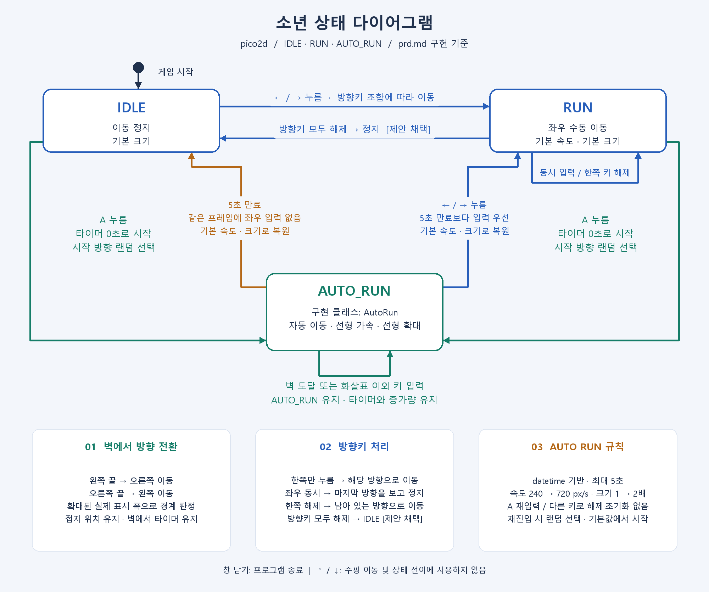

# pico2d AutoRun

소년의 `IDLE`, `RUN`, `AUTO_RUN` 상태 머신 데모이다. `boy.py`의 `AutoRun` 클래스가 자동 달리기를 담당한다.

## 실행

Python 3.13과 pico2d 1.5.1에서 확인했다. 프로젝트 폴더에서 실행한다.

```powershell
python -m pip install -r requirements.txt
python main.py
```

`python` 명령을 찾을 수 없으면 IDE에서 선택한 Python 실행 파일을 사용한다. 현재 PC의 설치 경로는 다음과 같다.

```powershell
& "$env:LOCALAPPDATA\Programs\Python\Python313\python.exe" main.py
```

이미지는 실행 파일 위치를 기준으로 찾으므로 다른 작업 폴더에서 실행해도 된다.

## 조작

| 입력 | 동작 |
| --- | --- |
| ← / → | 해당 방향으로 기본 이동. AUTO RUN 중에는 이를 해제하고 RUN으로 전환한다. |
| 좌우 키 동시 유지 | 마지막으로 누른 방향을 바라보며 정지한다. 한쪽을 놓으면 남은 방향으로 이동한다. |
| 이동 방향키 모두 해제 | IDLE로 전환한다. |
| A | IDLE 또는 RUN에서 AUTO RUN에 진입한다. |
| AUTO RUN 중 A / 그 외 키 | AUTO RUN 상태와 타이머를 유지한다. ↑ / ↓는 수평 이동과 상태 전이에 사용하지 않는다. |
| 창 닫기 | 프로그램을 종료한다. |

AUTO RUN은 매 진입 시 좌우 중 랜덤 방향으로 출발하고 벽에서 반사한다. 5초 동안 속도는 240→720px/s, 크기는 1→2배로 선형 증가하며, 만료 또는 좌우 방향키 입력 시 기본값으로 복원한다. 같은 프레임에 만료와 좌우 방향키 입력이 있으면 입력이 우선한다. 확대·복원 중 발의 잔디 접지 위치는 고정된다.

창이 포커스를 잃으면 눌린 방향키 기록을 지워 수동 이동을 정지한다. AUTO RUN은 포커스를 잃어도 원래 타이머대로 동작한다. HUD 글꼴을 찾지 못하는 환경에서는 창 제목으로 현재 상태·속도·크기를 확인할 수 있다.

## 구성과 조정

- `main.py`: 창·이벤트·`datetime` 게임 루프·화면 상태 표시
- `boy.py`: `Boy`, `Idle`, `Run`, `AutoRun` 및 애니메이션
- `grass.py`: 잔디 리소스 로드·표시
- `config.py`: 800×600 화면, 기본 속도, 지속 시간, 증가 배율, 애니메이션 설정
- `prd.md`: 확정 요구사항과 검수 기준
- `state_diagram.png`: 상태 다이어그램 이미지

스프라이트는 100×100 프레임 8열·4행을 사용한다. 이미지의 투명 여백을 제외한 실제 표시 폭으로 벽을 판정한다. 이미지를 교체하면 `boy.py`의 `SPRITE_BOUNDS`도 새 이미지에 맞춰 갱신해야 한다.

## 검증 및 다이어그램 재생성

```powershell
python -m pip install -r requirements-dev.txt
python -m unittest discover -s tests -v
python tools/smoke_render.py
python tools/draw_state_diagram.py
```

`smoke_render.py`는 SDL 비표시 드라이버로 실제 입력 큐·렌더링·만료·복원·종료를 검증하고, `artifacts/`에 화면 PNG 6개와 JSON 보고서를 저장한다. `artifacts/`는 Git에서 제외된다. `draw_state_diagram.py`는 Pillow와 한글 글꼴(Windows의 맑은 고딕 등)을 사용해 `state_diagram.png`를 재생성한다.


